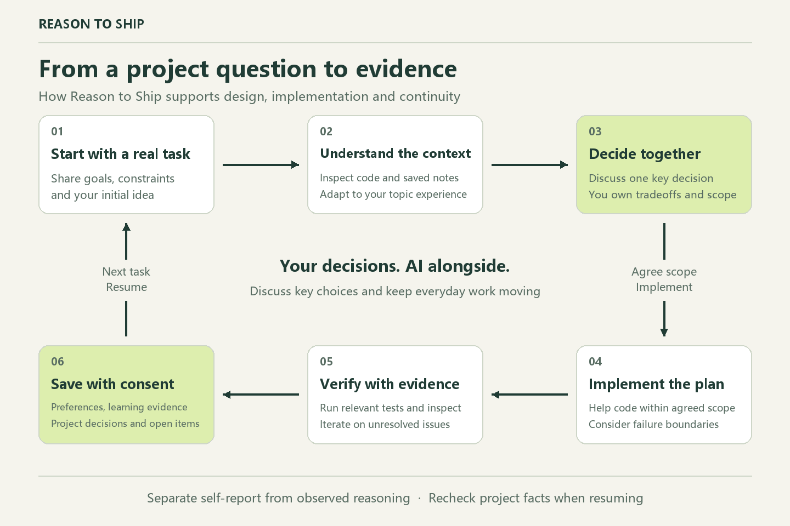

# Reason to Ship 🚢

Current release: **v0.2.0** · [Release notes](CHANGELOG.md)

**Think independently. Ship with evidence.**

[中文说明](README.zh-CN.md) · [Cases / 案例](cases/README.md)

**Standalone installs:** [.agents and .codex skill ZIPs](INSTALL.md) include all five bilingual cases. These preview packages resume state when invoked and do not install the Claude SessionStart hook.

Reason to Ship is a learning skill for *real engineering work*, available as a standalone skill for Codex and a plugin for Claude Code. It builds a repeatable habit: understand the problem → weigh options → trace code and data → consider failures → verify the result. AI can write the implementation; the engineer owns the decisions.

## How it works

Bring a real project task. Discuss key choices, implement the agreed scope, verify the result, and save context with consent for the next task.



## Install in Codex

1. Download the [v0.2.0 .agents skill package](https://github.com/bluefateludi/reason-to-ship/releases/download/v0.2.0/reason-to-ship-v0.2.0-agents.zip).
2. Extract it into the project where you want to use it. The entrypoint should be `<your-project>/.agents/skills/reason-to-ship/SKILL.md`. To use it across projects, extract into your home directory instead.
3. Open that project in Codex and invoke the skill:

```text
$reason-to-ship Help me design this feature. Start with my idea and discuss one key decision at a time.
```

In Codex CLI and the IDE extension, type `$` or use `/skills` to select it. If the skill does not appear, restart Codex. These discovery locations and invocation methods follow the [official skills documentation](https://learn.chatgpt.com/docs/build-skills).

The package includes bilingual cases, personalization, project notes and backed-up resets. Saved notes resume when the skill is invoked. Package extraction and reset checks are automated; actual client discovery and multi-turn dialogue acceptance remain pending. [Platform-specific install commands and checksums](INSTALL.md).

## Install locally (Claude Code)

```bash
claude --plugin-dir /absolute/path/to/reason-to-ship
```

In Claude Code: `/reason-to-ship:train`. Marketplace installation can be configured after publishing the repo. Requires Python 3.8+ for the optional read-only SessionStart hook.

Point `--plugin-dir` at the folder containing `.claude-plugin`. The hook uses Bash (Git Bash on Windows) and tries `python3`, `python`, then `py -3`, checking for Python 3.8+. If none is available, it reports the missing dependency on stderr and skips recovery without blocking the session.

## In practice

**You:** Add retries to this model request.

**Skill:** Which errors should be retried? If a parameter is invalid, would sending the same request again help?

The assistant then helps inspect the real implementation, agree on boundaries, implement an approved change, run tests and explain the result. Five design lenses are **not** five obligatory questions. The learner can skip or request direct implementation.

## Learning continuity

With consent to save progress, each project's `.reason-to-ship/` holds three compact notes:

- `learner.md`: project situation, overall and per-stack experience, goals, preferences and concept snapshots.
- `learning-log.md`: topic-based learning evidence and pending decisions.
- `project-context.md`: requirements, components, flows, trust boundaries, verified build commands and unknowns.

The [templates](skills/train/state-templates.md) and [onboarding workflow](skills/train/personalization.md) are adapted from VibeWise with renamed files; [upstream attribution and MIT license](skills/train/THIRD_PARTY_NOTICES.md) are included in standalone packages. Reuse known answers, ask one setup question at a time, and allow defaults or skipped setup. Unknowns remain unspecified; self-reported experience is not demonstrated understanding. Default to companion-style guidance at important project design decisions, while keeping small changes moving.

Legacy `state.md` and `decisions.md` remain readable without automatic migration. New learner state controls activation when both exist; legacy pending decisions must still be checked. Keep self-report separate from observed reasoning, recording the source task, hints and uncertainty. Recheck stale project facts before use. The Claude Code SessionStart hook emits a read-only, bounded recovery pointer. Standalone packages resume only when invoked. Keep personal notes uncommitted.

## Backed-up reset

Use `/reason-to-ship:reset` in Claude Code, or ask `$reason-to-ship` to reset saved learning in a standalone install. Python 3.8+ is required for reset. The agent previews the project, affected files and scope, waits for confirmation, then applies that exact preview:

| Scope | Clear | Preserve |
| --- | --- | --- |
| Learning (default) | Concept snapshots and learning evidence | Preferences, self-report, project designs and pending decisions |
| Project | Project map, project-specific fields, designs and pending decisions | Preferences, self-report and historical learning evidence |
| All | All of the above | Source code, unrelated files and backups |

The helper backs up all existing managed notes under `.reason-to-ship/backups/`, verifies copies and a hash manifest, then changes notes. It preserves pending decisions during a learning reset. Backup failure leaves active notes unchanged; an interrupted write leaves a recovery marker rather than claiming success. Cleared context must not be recreated from old chat or backups. See the [reset workflow](skills/train/reset.md). Backup restoration is separately reviewed; no automatic restore command is bundled.

## v0.2.0

- Bilingual training and reset skills, five engineering lenses, guided → independent → later authentic transfer evidence
- Five original bilingual scenario briefs: retry, idempotency, cache consistency, rate limiting, async jobs
- Claude Code hook plus Python unit tests, manual dialogue evaluation checklist

**Limitations:** Automatic tests cannot prove learning outcomes. Standalone skill packages are available for `.agents` and `.codex`; full Codex lifecycle integration and cross-client dialogue acceptance remain unverified. A live Claude CLI run recognized the plugin and training command, but dialogue acceptance is still incomplete. See [validation results](tests/validation-2026-11-08.md).

## Checks

```bash
python -B -m unittest discover -s tests -v
python -m json.tool .claude-plugin/plugin.json
python -m json.tool hooks/hooks.json
```

Use `python3` if your system exposes Python 3 under that name. On Windows without symlink creation privileges, the symlink integration test is reported as skipped, not passed.

## Contributing

Cases must be original or properly licensed; do not copy textbook answers. See [CONTRIBUTING.md](CONTRIBUTING.md). MIT license.
