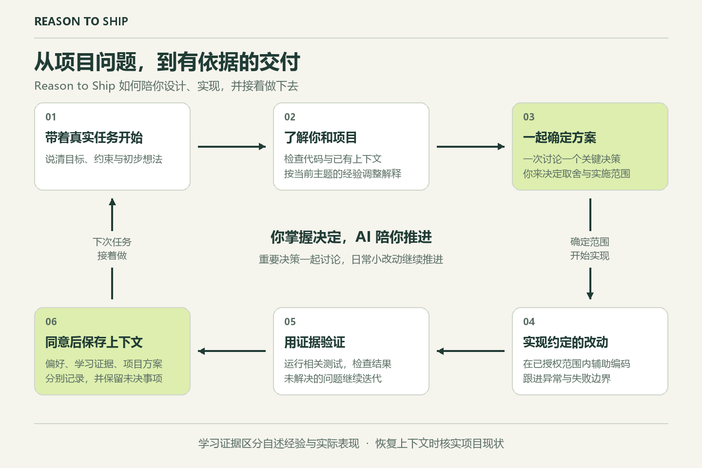

# Reason to Ship 🚢

当前版本：**v0.2.0** · [更新记录](CHANGELOG.md)

**独立思考，以证据交付。**

[English](README.md) · [工程案例库](cases/README.md)

**独立技能安装：** 提供 [.agents 通用包和 .codex 包](INSTALL.md)，内含五个双语案例。预览包在调用时恢复状态，不安装 Claude SessionStart Hook。

在你做项目、设计方案时，AI 默认在重要决策处陪伴讨论：先了解你的想法，根据经验解释概念与取舍，在授权范围内辅助实现和验证。日常小改动正常推进，也可以随时要求直接实现。没有项目任务时，可选择一个工程案例。

## 如何陪你推进项目

带着真实项目问题开始，一起讨论关键决策，在约定范围内实现并验证。同意保存后，下次从已有方案与未决事项继续。



## Codex 安装包（.codex）

1. 下载 [v0.2.0 Codex 安装包](https://github.com/bluefateludi/reason-to-ship/releases/download/v0.2.0/reason-to-ship-v0.2.0-codex.zip)。
2. 适用于读取 `~/.codex/skills` 的 Codex 环境。解压到用户主目录，确认入口为 `~/.codex/skills/reason-to-ship/SKILL.md`。自定义了 `CODEX_HOME` 时，将解压后的 `reason-to-ship` 文件夹放入 `$CODEX_HOME/skills/`。
3. 在 Codex 中打开该项目，输入下面的请求。

```text
$reason-to-ship 陪我设计这个功能，先听我的想法，每次讨论一个关键决策。
```

Codex CLI 和 IDE 扩展可通过输入 `$` 或 `/skills` 选择技能。安装后未出现时，重启 Codex。当前 [OpenAI 官方技能文档](https://learn.chatgpt.com/docs/build-skills)列出的本地发现目录为 `.agents/skills`，使用这些目录的客户端可选下方通用包。

包内包含双语案例、个性化、项目上下文与带备份的重置。已保存的记录在调用技能时恢复。解压布局与重置已有自动检查，真实客户端发现和多轮对话验收仍待完成。操作系统对应命令和校验方法见[安装指南](INSTALL.md)。

## 通用技能包（.agents）

下载 [v0.2.0 .agents 通用包](https://github.com/bluefateludi/reason-to-ship/releases/download/v0.2.0/reason-to-ship-v0.2.0-agents.zip)，解压到项目根目录或用户主目录，入口为 `.agents/skills/reason-to-ship/SKILL.md`。此目录适配当前 Codex 的技能发现方式，也可供支持该目录的其他客户端使用。其他客户端按各自的技能界面调用。

两个 ZIP 的技能资源相同，安装目录不同。同一客户端可见范围内安装一份即可。目录选择和具体命令见[安装指南](INSTALL.md)。

## Claude Code 本地启动

```bash
claude --plugin-dir /你的绝对路径/reason-to-ship
```

在 Claude Code 输入 `/reason-to-ship:train`。Hooks 和重置脚本使用 Python 3.8+，无需数据库或账号。

`--plugin-dir` 应指向包含 `.claude-plugin` 的目录。Hook 使用 Bash（Windows 使用 Git Bash），依次检查 `python3`、`python`、`py -3` 是否满足 Python 3.8+。均不可用时向标准错误输出提示并跳过恢复，不阻塞会话。

## 使用节奏

**理解问题 → 比较方案 → 走通代码链路 → 考虑异常 → 验证交付。** 五层只是内部检查角度，不会强迫用户回答五道题。每次最多追问一个关键决策；不知道时可以要求解释，也可以直接请求实现。

学习证据分为三种：在引导下完成、独立解释、未来真实任务中的迁移应用。第三种不作为本次交付的阻塞条件。不能把 AI 的解释或用户的同意记成用户已经掌握。

## 学习连续性

同意保存后，在项目 `.reason-to-ship/` 中使用三份记录：

| 文件 | 内容 |
| --- | --- |
| `learner.md` | 项目情况、总体与技术栈经验、目标、偏好、概念理解快照 |
| `learning-log.md` | 按主题积累的学习证据与待确认决策 |
| `project-context.md` | 需求、组件、流程、数据边界、构建部署和未知项 |

沿用 VibeWise 的模板与初始化流程，并改为以上文件名。设置一次只问一项，复用已有答案，支持默认设置或跳过；未知内容写“未说明”，自述等级不等于掌握证据。见[中文模板](skills/train/state-templates.zh-CN.md)与[个性化流程](skills/train/personalization.zh-CN.md)。原作者的版权与 MIT 许可保存在[第三方说明](skills/train/THIRD_PARTY_NOTICES.md)，安装包也包含该说明。

旧版 `state.md`、`decisions.md` 仍可读取，不自动迁移；新旧并存时以新档案的学习模式为准，旧决策的待确认项仍需检查。自述经验与观察证据分开保存；后者记录具体任务、推理表现、提示程度与不确定性。恢复时核实可能过时的项目事实，不把历史方案当成当前授权。只读 SessionStart Hook 提供恢复提示，独立技能包仅在调用时恢复。请勿把个人记录提交进公开仓库。

## 带备份的重置

Claude Code 使用 `/reason-to-ship:reset`；独立技能使用 `$reason-to-ship 重置学习记录`。先展示项目、范围、受影响文件和保留内容，确认后才执行。默认只清学习记录，可选择只清项目上下文或全部重置：

| 范围 | 清除 | 保留 |
| --- | --- | --- |
| 仅学习记录 | 概念理解摘要与学习证据 | 偏好、自述经验、项目方案和待确认决策 |
| 仅项目上下文 | 项目地图、项目字段、方案和待确认决策 | 偏好、自述经验与历史学习证据 |
| 全部 | 上述所有档案内容 | 源码、无关文件与备份 |

脚本先把现有受管记录完整备份到 `.reason-to-ship/backups/` 并校验，成功后才修改。学习日志中的待确认决策不会随默认重置被删除。备份失败保留原记录；写入中断会留下未完成标记，恢复流程会要求检查，不误报成功。重置后不从旧聊天或备份自动补回已清空的记忆。详情见[中文重置流程](skills/train/reset.zh-CN.md)。尚无自动恢复备份命令，恢复需单独审阅。

## v0.2.0 范围

训练与重置两个 Claude Code Skills、五个原创中英双语案例、只读 Hooks、单元测试与人工对话测试清单；另提供包含相同重置流程的 `.agents` 和 `.codex` 独立技能安装包。Codex 生命周期集成和跨客户端对话验收尚未完成，暂不包含 Web 服务、积分系统或独立案例网站。

## 测试

```bash
python -B -m unittest discover -s tests -v
```

如果系统的 Python 3 命令是 `python3`，请使用该命令。Windows 缺少创建符号链接权限时，对应集成测试会明确标记为跳过，而非通过。

**当前限制：** 自动测试只能验证 Hook 等程序行为，不能证明用户真的提升能力。真实 CLI 已识别插件和训练命令，但对话验收尚未完成，详见[验证记录](tests/validation-2026-11-08.md)。
